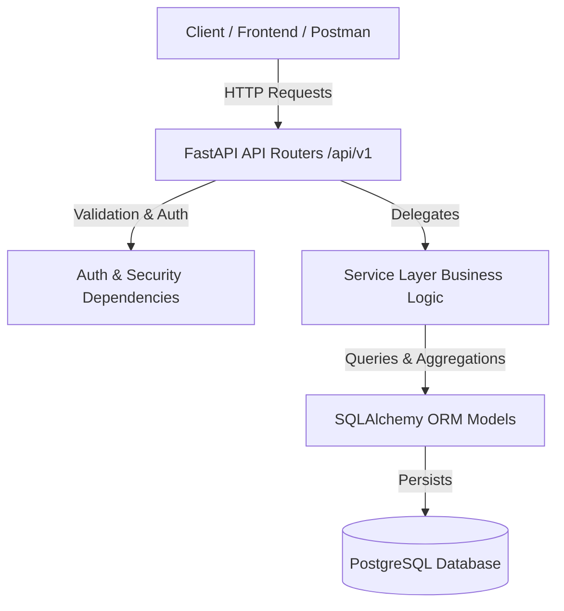

<div align="center">

# 💎 KnowFin

### *Production-Grade Personal Expense Tracker API*

[](https://www.python.org/)
[](https://fastapi.tiangolo.com/)
[](https://www.postgresql.org/)
[](https://www.docker.com/)
[](https://opensource.org/licenses/MIT)

---

**KnowFin** is a backend RESTful service engineered with modern backend design principles. It features JWT-based authentication, user-isolated expense management, customizable categories, monthly budgets, aggregate SQL analytics, rate limiting, structured logging, and containerized deployment.

[Key Architecture](#-key-architecture) • [Features](#-key-features) • [Tech Stack](#-tech-stack) • [Quickstart](#-quickstart) • [API Documentation](#-api-documentation-summary)

---

</div>

## 🏗️ Key Architecture

KnowFin enforces a strict layered backend architecture to separate concerns and guarantee scalable maintainability:



- **API Layer (`app/api`):** Handles HTTP routing, input validation via Pydantic, and request/response serialization.
- **Service Layer (`app/services`):** Encapsulates pure business logic, database transactions, and custom query aggregations.
- **Data Layer (`app/models`):** Manages relational schema definitions, constraints, indices, and foreign key cascades.
- **Core Platform (`app/core`):** Configures security tokens, structured JSON logging, global exception handling, and IP-level rate limiting.

---

## ⚡ Key Features

- 🔐 **Authentication & Security:** JWT access token flow, bcrypt password hashing, and OAuth2 security schemes.
- 📦 **Expense Management:** Multi-attribute expense CRUD with strict user-level data isolation.
- 🔍 **Advanced Querying:** Server-side pagination, date-range & category filtering, and sorting allowlists.
- 🎯 **Categories & Budgets:** Custom category management with monthly spending targets and FK cascading deletion.
- 📊 **SQL Analytics Engine:** Single-query aggregate statistics (`SUM`, `COUNT`, `GROUP BY`, `COALESCE`) for total spend, category percentage breakdowns, and budget compliance tracking.
- 🛡️ **Production Observability:** Structured JSON logging, HTTP request duration middleware, and `slowapi` rate limiting.
- 🐋 **Docker Containerization:** Multi-stage Dockerfile and Docker Compose orchestration with PostgreSQL health checks.

---

## 🛠️ Tech Stack

| Component | Technology | Description |
|---|---|---|
| **Language** | Python 3.9 | Modern async-compatible backend runtime |
| **Framework** | FastAPI | High-performance, ASGI-compliant REST framework |
| **Database** | PostgreSQL 15 | Relational database engine |
| **ORM** | SQLAlchemy 2.0 | Python SQL Toolkit and Object Relational Mapper |
| **Migrations** | Alembic | Database schema migration management |
| **Security** | PyJWT + bcrypt | Token generation and password hashing |
| **Rate Limiting** | slowapi | Token bucket rate limiting middleware |
| **Testing** | pytest + httpx | Automated unit & integration testing framework |
| **DevOps** | Docker & Compose | Multi-stage container builds and service orchestration |

---

## 📁 Repository Layout

```
KnowFin/
├── app/
│   ├── api/
│   │   ├── deps.py                  # JWT Auth & DB session dependencies
│   │   └── v1/
│   │       ├── analytics.py         # Dashboard analytics endpoints
│   │       ├── auth.py              # User registration & JWT login
│   │       ├── categories_budgets.py# Category & budget endpoints
│   │       └── expenses.py          # Paginated expense CRUD
│   ├── core/
│   │   ├── config.py                # Environment setting loader
│   │   ├── exceptions.py            # Global exception handlers
│   │   ├── limiter.py               # Rate limiter configuration
│   │   └── logging.py               # JSON structured log formatter
│   ├── db/                          # Base class & session factory
│   ├── models/                      # SQLAlchemy ORM model definitions
│   ├── schemas/                     # Pydantic request/response schemas
│   ├── services/                    # Business & domain service layer
│   └── main.py                      # Application entrypoint & middleware
├── alembic/                         # Database migrations directory
├── scripts/
│   └── seed.py                      # Sample database seeder
├── tests/                           # Integration test suite
├── Dockerfile                       # Production multi-stage build file
├── docker-compose.yml               # Service orchestration configuration
├── Makefile                         # Task automation commands
└── requirements.txt                 # Project dependencies
```

---

## 🚀 Quickstart

### Option 1: Docker Compose (Recommended)

Run the entire application stack (PostgreSQL + FastAPI) with a single command:

```bash
# 1. Clone the repository
git clone https://github.com/yourusername/KnowFin.git
cd KnowFin

# 2. Copy environment file
cp .env.example .env

# 3. Spin up services
docker compose up --build
```

The server will automatically apply Alembic migrations and start listening at `http://localhost:8000`.

---

### Option 2: Local Development Setup

```bash
# 1. Create and activate virtual environment
python3 -m venv .venv
source .venv/bin/activate

# 2. Install dependencies
pip install -r requirements.txt

# 3. Configure environment variables
cp .env.example .env

# 4. Apply database migrations
alembic upgrade head

# 5. (Optional) Seed demo data
python scripts/seed.py

# 6. Run development server
uvicorn app.main:app --reload
```

---

## 🧪 Testing & Automation

Run the full automated test suite using `make`:

```bash
# Run pytest test suite
make test

# View available Makefile automation commands
make help
```

---

## 📑 API Documentation Summary

Once running, interactive API documentation is accessible at:
- **Swagger UI:** `http://localhost:8000/docs`
- **ReDoc:** `http://localhost:8000/redoc`

### Overview of Endpoint Groups

| Group | Method | Path | Description |
|---|---|---|---|
| **System** | `GET` | `/health` | Server status & environment check |
| **Auth** | `POST` | `/api/v1/auth/register` | User registration |
| **Auth** | `POST` | `/api/v1/auth/login` | JWT login token generation |
| **Auth** | `GET` | `/api/v1/auth/me` | Fetch authenticated user profile |
| **Expenses** | `GET` | `/api/v1/expenses/` | Paginated, filterable expense list |
| **Expenses** | `POST` | `/api/v1/expenses/` | Create a new expense entry |
| **Expenses** | `GET` | `/api/v1/expenses/{id}` | Fetch single expense details |
| **Expenses** | `PUT` | `/api/v1/expenses/{id}` | Update existing expense |
| **Expenses** | `DELETE` | `/api/v1/expenses/{id}` | Delete an expense entry |
| **Categories** | `GET` | `/api/v1/categories/` | List user categories |
| **Categories** | `POST` | `/api/v1/categories/` | Create a new user category |
| **Categories** | `DELETE` | `/api/v1/categories/{id}` | Delete category |
| **Budgets** | `GET` | `/api/v1/budgets/` | List monthly category budgets |
| **Budgets** | `POST` | `/api/v1/budgets/` | Set or update category budget |
| **Analytics** | `GET` | `/api/v1/analytics/summary` | Total monthly spend summary |
| **Analytics** | `GET` | `/api/v1/analytics/by-category` | Category percentage breakdown |
| **Analytics** | `GET` | `/api/v1/analytics/budget-status` | Budget compliance & remaining limits |

---

## 📜 License

This project is licensed under the MIT License - see the [LICENSE](LICENSE) file for details.
